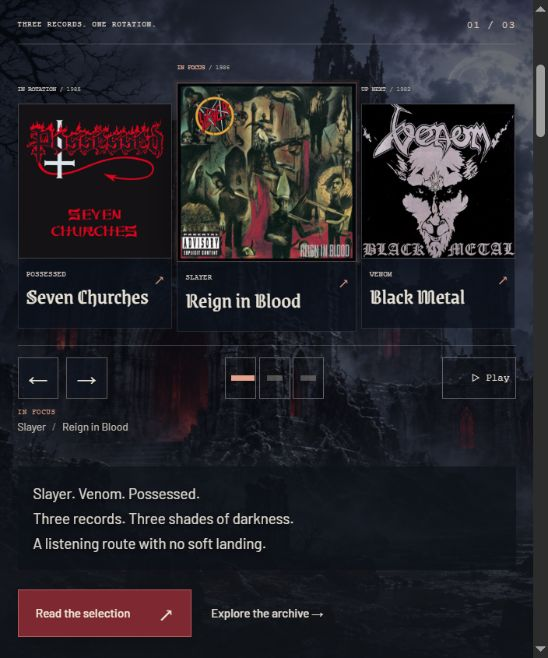

# RIFF CULT

An independent metal journal, discovery archive and private record collection. The Gothic Editorial design has been carried into a working Next.js application.

**[Live portfolio demo](https://riff-cult.vercel.app)** · **[Documentation index](docs/README.md)** · **[Case study](docs/CASE_STUDY.md)**



## Try the portfolio demo locally

Use Node.js 22 or later. No database or account credentials are needed for demo mode.

```powershell
npm ci
$env:DEMO_MODE='true'
npm run dev
```

Open [RIFF CULT](http://127.0.0.1:4318). Owned/Wishlist entries stay in this browser, and the editorial workspace is a read-only preview. Remove the `DEMO_MODE` override before using the full application below.

## Run the full application locally

Node.js 22 or later is required.

```powershell
npm ci
node scripts/setup-local.mjs
npm run db:migrate
npm run dev
```

Open [RIFF CULT](http://127.0.0.1:4318). Local PostgreSQL storage is embedded on the server and persists in `.data/postgres`; Docker is not required. `.env.local` and the database are ignored by Git. No default administrator credentials are created.

For the optimized version:

```powershell
npm run check
npm test
npm run build
npm start
npm run test:smoke
```

## Included in R1

- Gothic front page with optional atmosphere motion and a rotating Slayer / Venom / Possessed opening. All three covers remain visible, with the central cover slightly larger. Eight records fill the lower selection.
- Nine credited album covers and completed track sequences; seven band introductions; five populated genre branches.
- Album and band discovery, query-based filters, deliberate sorts, pagination and preserved archive return context.
- Server-rendered album, band, genre, review and listening-list routes.
- Email/password registration, sign-in, sign-out, account settings and protected sessions through Better Auth.
- Private server-persisted Owned/Wishlist collections, Grid/Shelf views, unique entries, removal and Undo.
- Role-protected catalog, band and writing editing; drafts, previews, publication and featured-order controls. Administrators can manage account access.
- SQL migrations, reproducible seed data, integration tests, Docker configuration and deployment documentation.

Create the intended operator account through the site, stop the local server, then grant access with `npm run admin:grant -- owner@example.com admin`. Restart and sign in. Editors can maintain content; only administrators can grant access. Do not run a separate database CLI against a live embedded database instance.

## Portfolio demo on Vercel

**Live demo:** [riff-cult.vercel.app](https://riff-cult.vercel.app).

The portfolio version works without account registration or a hosted database. Vercel automatically enables demo mode when no `DATABASE_URL` is configured. Visitors can explore every public page, try Owned/Wishlist in their browser and view the read-only editorial workspace. Collections stay on that browser; publishing, account creation and server collection writes are disabled.

The server-backed application remains available locally or with a configured PostgreSQL database. Its accounts, private collections and access controls are separate from the portfolio demo. Set `DEMO_MODE=false` to require full application mode explicitly. Concerts and community features remain in later roadmap phases.

See [Vercel deployment](docs/VERCEL_DEPLOYMENT.md) for setup, demo behavior and the optional database-backed configuration.

## Documentation

- [Documentation index and reading guide](docs/README.md)
- [Functional specification](docs/RIFF_CULT_FUNCTIONAL_SPEC.md)
- [Architecture, setup and deployment](docs/ARCHITECTURE.md)
- [Vercel portfolio demo](docs/VERCEL_DEPLOYMENT.md)
- [Application verification](docs/APPLICATION_QA.md)
- [Portfolio case study](docs/CASE_STUDY.md)
- [Roadmap and current delivery status](docs/RIFF_CULT_ROADMAP.md)
- [Artwork and font sources](docs/RIFF_CULT_ASSET_REGISTER.md)
- [Track metadata sources](docs/TRACK_METADATA_SOURCES.json)
- [Opening carousel revision](docs/CAROUSEL_REVISION.md)
- [Repository contents and maintenance](docs/REPOSITORY.md)

The old design prototype is retained in `design/`; run `npm run design` to review it on 4317. Its local-storage vault is separate from application accounts. Historical design documents and screenshots record earlier stages, not the current application's capabilities. All project documentation is maintained in English.
